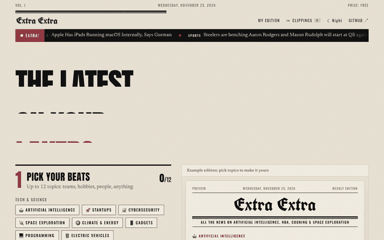
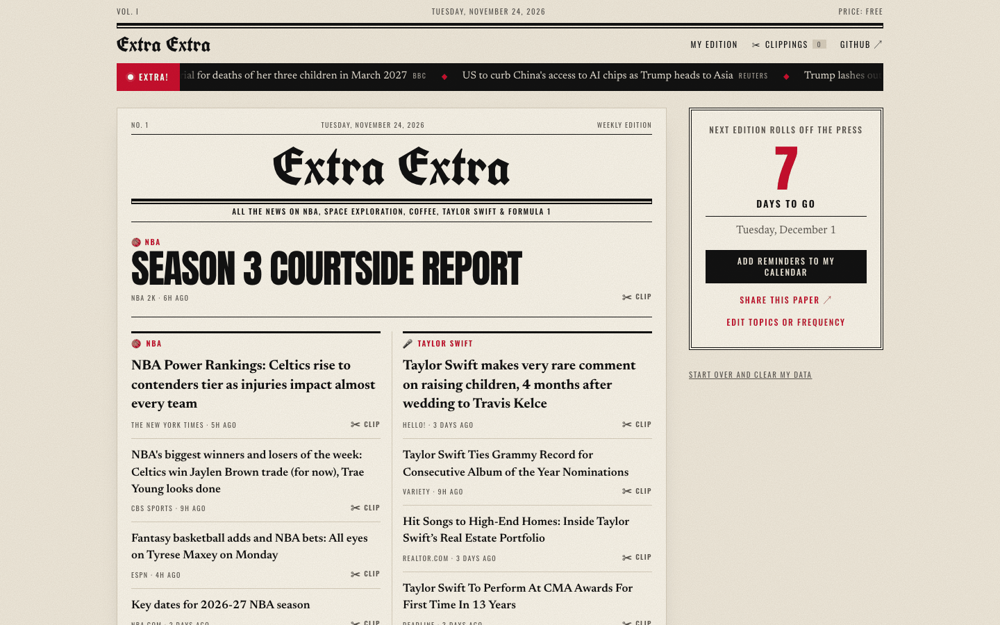
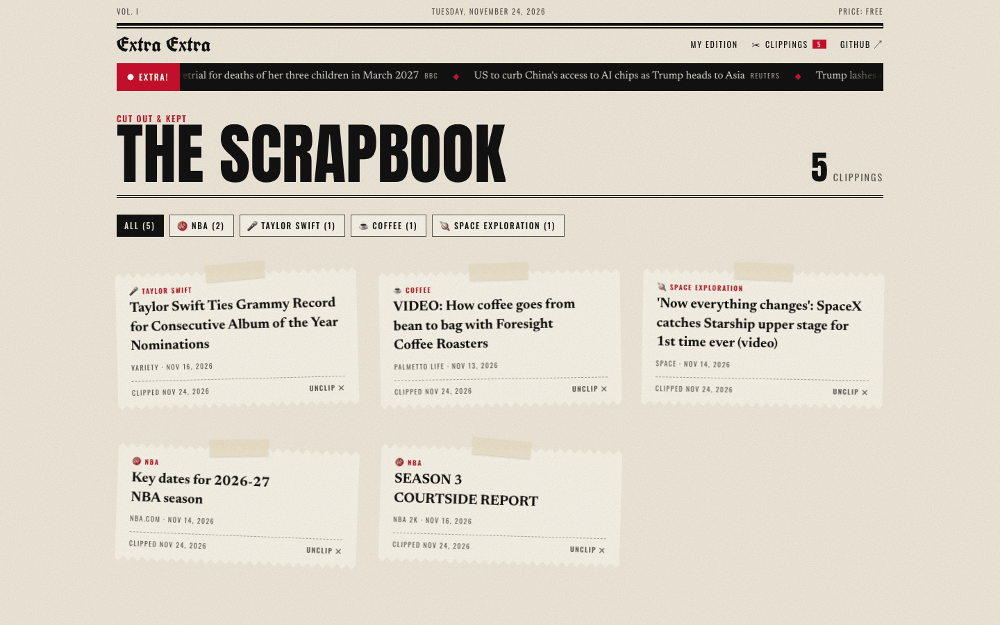
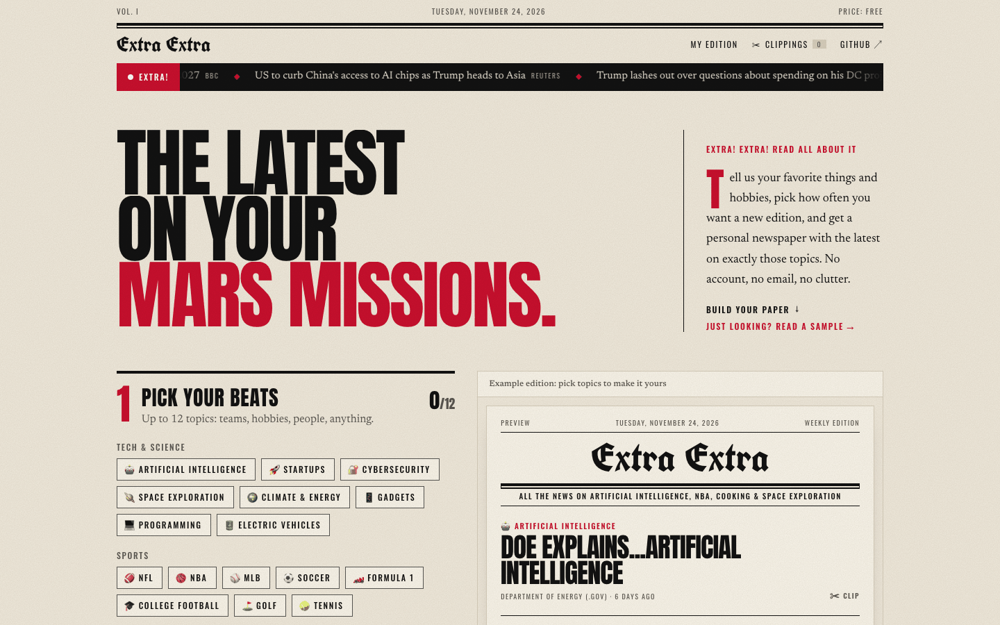
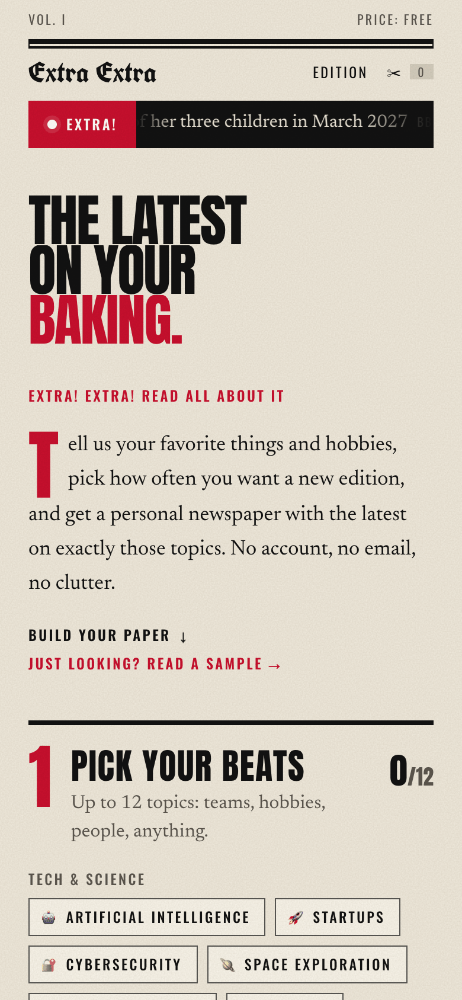

# Extra Extra

[](https://github.com/Prestoj01/personal-newsletter/actions/workflows/deploy.yml)

**A free, personal newspaper about exactly the things you care about. It runs entirely on GitHub Pages.**

**[Open the live site →](https://prestoj01.github.io/personal-newsletter/)** · **[Read a sample paper →](https://prestoj01.github.io/personal-newsletter/read/?beats=artificial-intelligence,nba,space-exploration,coffee,taylor-swift,formula-1&run=weekly)**

<p align="center">
  
</p>

Pick your interests from 40+ topic chips, or type in anything else: a team, a person, a company, a hobby. Then choose daily, weekly, biweekly, or monthly. Extra Extra prints a new edition of the latest headlines for those topics on your schedule and keeps an archive of past editions.

- **Live preview.** As you pick topics, a real edition built from current news typesets itself next to the builder.
- **No account, no email, no server.** Your picks, past editions and clippings live in your browser.
- **Shareable papers.** Every paper is a link. Anyone who opens it gets the same paper with today's news.
- **Clippings.** Cut stories out of any edition into a scrapbook.
- **Calendar reminders.** One click downloads a recurring `.ics` reminder that matches your frequency.
- **Costs $0 to run.** It's a static site, and the headlines are refreshed by a scheduled GitHub Action.

| Your edition | The scrapbook |
| --- | --- |
|  |  |

| The builder | On a phone |
| --- | --- |
|  |  |

## How it works

```
GitHub Actions (every 6 hours)
  └─ scripts/fetch-news.ts ── Google News RSS ──► public/data/topics/*.json  (one small file per topic)
                                                  public/data/search.json    (title index for free-text topics)
  └─ next build (static export) ──► GitHub Pages

Browser
  └─ downloads only the selected topics' files ──► builds the edition ──► saves it in localStorage
```

Browsers can't call Google News directly because it doesn't allow cross-origin requests. Instead, the deploy workflow fetches headlines on the server side, about 500 feeds per run, and publishes them as static JSON next to the site.

| Piece | Where |
| --- | --- |
| Topic chips, searchable catalog, aliases | `src/lib/topics.ts` |
| Headline fetching (runs in CI) | `scripts/fetch-news.ts` |
| Loading data and matching free-text topics in the browser | `src/lib/sources.ts` |
| Building an edition and de-duplicating stories | `src/lib/edition.ts` |
| Edition schedule (daily, weekly, biweekly, monthly) | `src/lib/frequency.ts` |
| Saved preferences and edition archive | `src/lib/storage.ts` |
| UI | `src/components/`, `src/app/` |

### Design notes

- **Small downloads.**
  - Each known topic has its own file of about 7 KB gzipped, so a reader downloads only the topics they picked.
  - Free-text topics first search a title-only index, then fetch just the topic files that hold the matching stories.
  - Google News article URLs are stored in compressed form.
- **About 165 known topics.**
  - Besides the chips, a searchable catalog (teams, companies, people, franchises, hobbies) has dedicated feeds.
  - Aliases map to the full topic, so typing "chiefs" gives you **Kansas City Chiefs**.
  - Anything else matches against roughly 5,000 recent headlines.
- **Editions follow a schedule.** Editions are counted from the day you start, so a weekly reader sees the same issue all week. A new one is printed on the next publish day and the old one moves to the archive. Changing your topics or frequency starts a fresh edition.
- **Freshness checks.** Each section prefers the feed window that matches the reader's frequency (1, 7, or 30 days) and drops stories older than that window. A story that fits several topics appears only once.
- **Failure handling.**
  - If a feed fails during a refresh, the workflow reuses the copy that's currently live.
  - If too many feeds fail, the workflow refuses to publish.
  - GitHub pauses scheduled workflows after 60 days of repo inactivity, so the workflow makes an empty commit when needed to keep the schedule running.

## Design

Extra Extra is designed as a printed broadsheet: ink black and press red on newsprint, with square corners and a paper-grain overlay. It uses four typefaces:

- UnifrakturCook for the blackletter nameplate
- Anton for banner headlines
- Oswald for labels and datelines
- Newsreader for reading text

The motion is part of the design, and every piece of it respects `prefers-reduced-motion`:

| Moment | What happens | How |
| --- | --- | --- |
| First load | The nameplate stamps in, the double rule prints across, and the banner headline rises line by line. | CSS keyframes |
| Kinetic headline | "The latest on your ___" flips through real interests. Clicking the word adds that topic. | React + CSS 3D flips |
| Live ticker | Today's top stories loop in a wire-style band that pauses on hover. | CSS marquee over `ticker.json` |
| Picking a topic | Its metal-type chip flies on an arc into the live preview, which re-typesets: the lead slams in and stories print in reading order. | Web Animations API (`src/lib/fly.ts`) |
| Frequency | Rubber stamps thunk down in red ink when selected. | CSS |
| Print my edition | A printing press: rollers spin, the press shudders, your front page feeds out, and a PRINTED! stamp lands. You can skip it. | `PressOverlay.tsx` |
| Changing pages | Pages turn like a newspaper, from the right going forward and from the left going back, with the masthead anchored. | React `<ViewTransition>` |
| Scrolling | A compact masthead slides in, a giant outlined banner scrubs sideways, and sections rise into view. | CSS scroll timelines |
| Reader | The edition unfolds from the top fold. A countdown "ear" shows the next edition, and past editions sit in "The morgue". | CSS |

## Run it locally

```bash
npm install
npm run dev      # fetches headlines on first run, then opens http://localhost:3000
```

Run `npm run fetch-news` any time to refresh the local headlines.

## Tests

```bash
npm test                                  # 26 unit tests (Vitest)
npm run fixtures && npm run build         # build against deterministic sample headlines
npm run test:e2e                          # 20 browser tests (Playwright, desktop + phone)
```

- **Unit tests** cover the logic that's easy to get subtly wrong: edition numbering (including month-end clamping), look-back cutoffs and cross-topic de-duplication, free-text matching priority, share-link encoding, topic aliases, and the clippings store.
- **Browser tests** run the real flows on desktop and phone sizes: building and printing a paper, the kinetic headline, sample and shared papers, clipping to the scrapbook, and reduced motion. An [axe](https://github.com/dequelabs/axe-core) scan of every page fails on any serious WCAG A/AA violation.
- **CI** runs lint, typecheck, unit tests and browser tests on every push and pull request. The deploy happens only if they pass. Scheduled headline refreshes skip the tests, because the code hasn't changed.

`npm run fixtures` overwrites `public/data` with sample headlines. Run `npm run fetch-news` afterward to get real headlines back.

## Deploy to GitHub Pages

1. Push to `main`.
2. In the repo, go to **Settings → Pages → Build and deployment** and set the source to **GitHub Actions**.
3. The **Refresh news & deploy** workflow builds and publishes the site at `https://<user>.github.io/personal-newsletter/`. It then re-runs every 6 hours to refresh the headlines. You can also run it by hand from the **Actions** tab.

You don't need any accounts, API keys, or secrets.

## Tech

Next.js 16 (App Router, static export, view transitions), React 19, TypeScript, Tailwind CSS 4 (container queries, design tokens), CSS scroll-driven animations, the Web Animations API, GitHub Actions, and GitHub Pages.

Headlines come from Google News RSS, and every story links to its original publisher.
